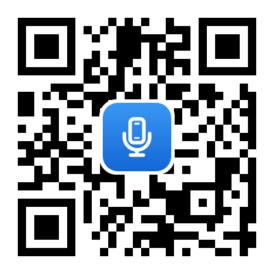

# Phomic

Your iPhone as a microphone for your Windows PC, over Wi-Fi, Bluetooth or a USB cable. Free and open source.

<!-- One line each: split over lines, GitHub takes the image out of the link. -->
<a href="https://apps.apple.com/app/phomic/id6835323092"><picture><source media="(prefers-color-scheme: dark)" srcset="appstore/badges/download-on-the-app-store-white.svg"></picture></a>

## Get started

1. **PC:** download [Phomic for Windows](https://github.com/Nordohm/Phomic/releases/latest) (Windows 10 or 11) and
   run the installer. The app isn't code-signed, so Windows may call the publisher unknown: *More info › Run anyway*.
2. **Microphone driver:** Phomic runs on [VB-CABLE](https://vb-audio.com/Cable/), a free driver by VB-Audio. Phomic's
   banner links to it. Unzip it, run `VBCABLE_Setup_x64.exe` as administrator and click *Install Driver*. Then click
   **Set up** in Phomic.
3. **iPhone:** install [Phomic](https://apps.apple.com/app/phomic/id6835323092) (iOS 18 or later) and tap your PC.
4. In Discord, Teams, OBS and so on, pick the microphone **Phomic**.

When Windows Firewall asks, allow Phomic on private networks.

| | Wi-Fi | Bluetooth | USB |
|---|---|---|---|
| Audio | 48 kHz, uncompressed | 48 kHz, Opus | 48 kHz, uncompressed |
| Delay | ~10 ms + buffer | ~20 ms + buffer | ~1 ms + buffer |
| Needs | the same network | the PC within about 10 m | a cable, and Apple's free [Apple Devices](https://apps.microsoft.com/detail/9NP83LWLPZ9K) app on the PC |

The buffer adapts to the connection: 20–200 ms (at least 30 ms on Bluetooth). You can switch while you talk: pick
another tab on the iPhone, or click **Switch** in the PC app.

## Troubleshooting

- **The iPhone doesn't list the PC (Wi-Fi):** both must be on the same network, and *Settings › Privacy & Security ›
  Local Network › Phomic* must be on.
- **Connected, but no sound (Wi-Fi):** allow Phomic in *Windows Security › Firewall › Allow an app* on private
  networks, and set the network to *Private*.
- **Bluetooth doesn't connect:** turn on *Bluetooth* in the PC app. If the PC says it can't accept connections, its
  adapter can't: use Wi-Fi or USB.
- **USB doesn't work:** the *USB* row in the PC app says why and offers the fix. Some cables only charge.
- **Crackles:** set *Buffering* to *Stable (120 ms)*.
- **Too quiet or too loud:** keep *Automatic gain* on, or turn it off and set *Gain* yourself.
- **Background noise:** turn on *Noise suppression* in the PC app, and leave the iPhone's Mic Mode on *Standard*.

## Support

If you'd like to support Phomic, you can [buy me a coffee](https://buymeacoffee.com/nordohm) ☕

## Development

Building the apps and how they work: [docs/development.md](docs/development.md). The protocols between them:
[docs/protocols.md](docs/protocols.md).

## License

[MIT](LICENSE), without any warranty. Phomic contains libopus and, on Windows, Microsoft's Windows App SDK under
their own terms ([details](windows/third_party/README.md)).

Phomic isn't made, sponsored or endorsed by Apple, Microsoft, VB-Audio or the Bluetooth SIG. Apple, iPhone, App Store
and Apple Devices are trademarks of Apple Inc. Windows is a trademark of Microsoft Corporation. Bluetooth is a
registered trademark of Bluetooth SIG, Inc.
